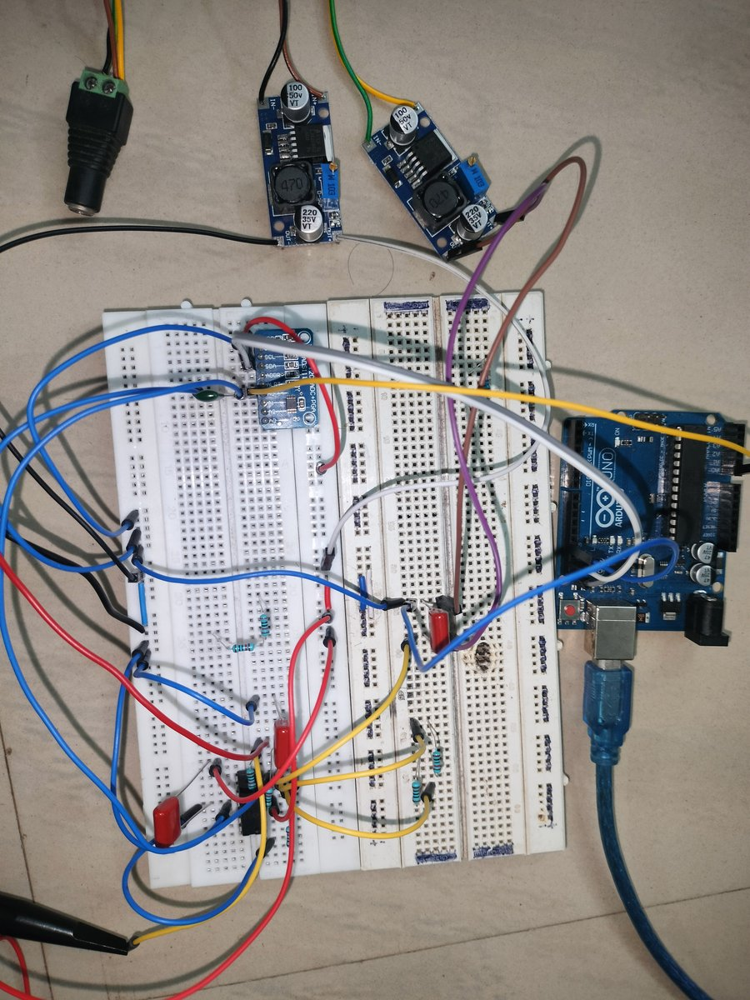

<h1 align="center">PC-Based Oscilloscope</h1>

<p align="center">
  A two-channel oscilloscope for slow signals: an op-amp front end and an ADS1115 ADC on an Arduino, with a Python app that draws both channels live and measures them. It reads AC and DC signals up to <b>±30 V</b>.
</p>

<p align="center">
  
  <br><sub>The finished board: Arduino Uno, ADS1115 ADC, MCP6004 op-amp, buck converters for the supply and offset, and screw-terminal inputs.</sub>
</p>

## Tested against a real oscilloscope

A function generator drives both a lab DSO and this board at the same time, so the laptop trace can be compared with the reference directly.

| Sine | Square | Triangle |
|---|---|---|
|  |  |  |

## From breadboard to perfboard

| First test on a breadboard | The Python app |
|---|---|
|  |  |

## How it works

<p align="center">
  
</p>

1. **Front end.** Each input goes through a **voltage divider**, then an **MCP6004** op-amp stage shifts it to sit around a mid-rail **voltage reference**, so a ±30 V signal fits the ADC's input range. ([pinout](MCP6004pins.png), [circuit diagram](Circuit_diagram_v1.pdf))
2. **ADC.** An **ADS1115** 16-bit ADC samples both channels and talks to the Arduino over I2C.
3. **Arduino.** The [sketch](arduino-code/arduino-code.ino) converts the readings back to input volts and streams them over USB serial at 115200 baud as `A0: <value> A1: <value>`.
4. **Python app.** The [Tkinter + Matplotlib app](gui-code/main_script.py) plots both channels live and shows amplitude, frequency, peak-to-peak, RMS, mean, high and low for each, with zoom sliders and an offset-correction toggle per channel.

## Parts

- Arduino Uno or Nano
- ADS1115 16-bit ADC module
- MCP6004 quad op-amp
- Buck converters for the offset reference (a 2.5 V reference IC is the better choice, see below)
- Resistor dividers, perfboard, screw terminals

## Run it

1. Flash [`arduino-code/arduino-code.ino`](arduino-code/arduino-code.ino) (needs the [ADS1X15 library](https://github.com/RobTillaart/ADS1X15)).
2. Install the Python packages:
   ```bash
   pip install pyserial matplotlib numpy
   ```
3. Set your serial port in `initialize_serial()` in [`gui-code/main_script.py`](gui-code/main_script.py) (`COM3` by default; `/dev/ttyACM0` or similar on Linux), then run:
   ```bash
   python gui-code/main_script.py
   ```

## Limitations

- **Signals up to about 100 Hz.** The ADS1115 and the Arduino's serial link limit the sample rate.
- **No input protection.** There is nothing yet to clamp overvoltage or spikes on the inputs.
- **Offset reference.** A buck converter sets the zero offset for now, where a proper 2.5 V reference IC would be more stable.

## Acknowledgments

[Arduino](https://www.arduino.cc/), [Matplotlib](https://matplotlib.org/) and the [ADS1X15 library](https://github.com/RobTillaart/ADS1X15).
